<h1 align="center">WeChat Copilot · WX智能聊天副驾</h1>

<div align="center">


-blue?logo=sqlite)


**为WX PC 端量身打造的贴边悬浮式 AI 智能沟通副驾**  
无感贴边跟随 · WX4.x数据库直读 · 自由拖拽缩放 · WX会话数据中枢 · 同层级智能沉浮 · 明暗双主题 · SQLite本地持久化 · 技能文件夹绑定 · AI问答对话军师 · 多维画像全景放大看板

[界面预览](#-软件界面精选预览) • [核心特性](#-核心特性) • [系统架构](#-系统架构) • [快速开始](#-快速开始) • [打包发布](#-打包发布-exe-安装文件) • [设置与功能指南](#-设置与功能指南) • [快捷键指南](#-快捷键指南) • [项目结构](#-项目结构) • [隐私与安全](#-隐私与安全)

</div>

---

## 📖 项目简介

**WeChat Copilot** 是一款专为 Windows 平台WX PC 端量身定制的**全域智能对话辅助桌面工具**。以轻量无边框的现代 Fluent 悬浮窗形态，自动贴合WX聊天窗口边缘，随WX窗口平滑移动与跨屏漫游；同时支持鼠标在边框任意拖拽自由缩放尺寸与明暗双主题无缝热重载。

项目严格遵循 **“本地优先 (Local-First)”** 与 **“只读不代发”** 的严苛安全原则：
- **WX 4.x 原生 WCDB4 解密直连（纯只读游标零风控）**：**内置 WCDB 4.0 原生只读解密与解析引擎**，直接读取本机 SQLite/WCDB 数据库，秒级提取长历史聊天记录与通讯录备注，彻底取消外部 HTTP API 依赖与屏幕视觉 OCR 抓屏，零进程注入、零内存 Hook、零封号风险；
- **WX会话与数据中枢（Tab 上方下拉中枢栏）**：集成【💬 最近会话快速切换】、【📊 关系冷热看板与互动统计】、【🔔 未读主动提醒与破冰跟进雷达】、【🗓️ 聊天关键事件、约定与承诺备忘】与【🔍 跨会话全库关键词检索】5 大高阶功能；
- **冷链路（深度认知与心智蒸馏）**：基于可插拔的 **Skill 认知蒸馏方法论**（职场商业协同、亲密关系心理、麦肯锡结构化逻辑等），生成动态自适应的多维雷达图谱与长效画像；
- **🤖 AI 对话军师（Antigravity 交互体系）**：主界面全新内嵌 AI 问答 Tab，支持融合本地画像与真实聊天记录进行多轮实时研判，配备多历史会话独立抽屉式管理与快捷探针指令；
- **SQLite 轻量化本地关系数据库**：引入 `Microsoft.Data.Sqlite` 开启 WAL 高并发模式。消息带 SHA256 唯一指纹幂等去重；在离线或无WX运行状态下依然能随时秒级加载历史、蒸馏画像与查阅记录；
- **Antigravity 风格技能文件夹绑定**：支持绑定工作区或指定目录，递归自动发现所有 `SKILL.md`，支持热重扫与物理安全删除；
- **多维画像全景放大看板**：提供全屏/大窗口深度研判体验，顶部动态提炼主导特质卡片，融合全景雷达图、量化得分对比柱状图、特质走势折线图与左右对照证据清单，支持一键导出 Markdown 分析报告。

---

## 🖼️ 软件界面精选预览

### 1. 贴边悬浮主界面四大核心 Tab

| 💬 贴边对话与引用气泡识别 (对话 Tab) | ✨ 意图驱动与博弈建议卡片 (建议 Tab) |
| :---: | :---: |
| 自动吸附WX边缘，富文本引用、图片预览与表情识别 | 终极目的锚定、多候选回复、量化推进力与画像安全度 |
| 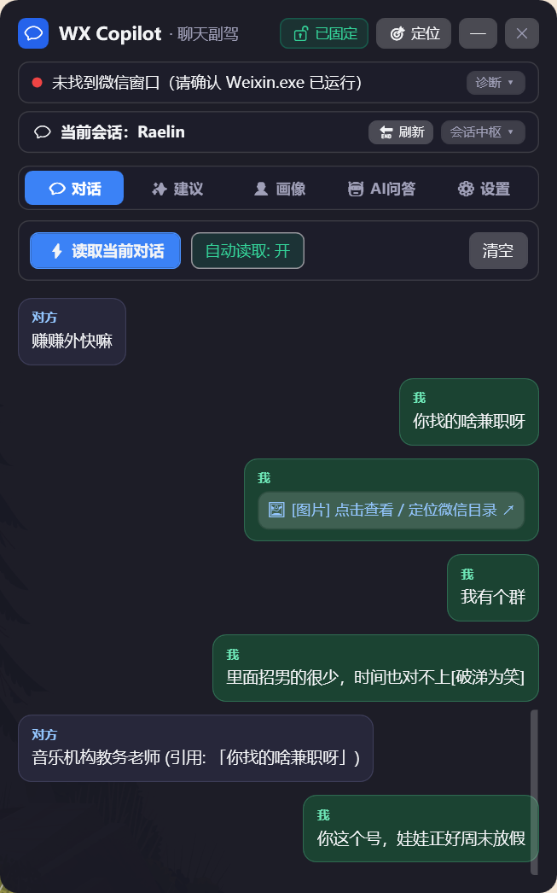 | 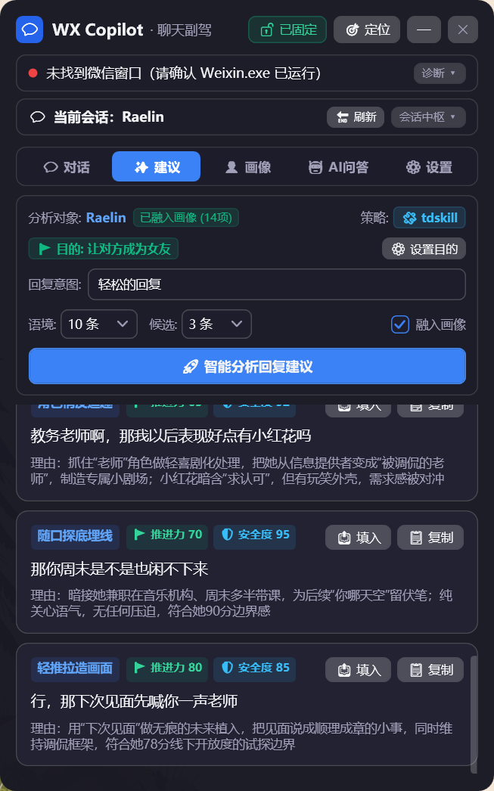 |

| 👤 多维心智特质画像 (画像 Tab) | 🤖 AI 问答对话军师 (AI问答 Tab) |
| :---: | :---: |
| 一键蒸馏多维特质，自适应多维认知雷达图谱与证据链 | Antigravity 交互美学，融合本地画像与真实聊天多轮研判 |
| 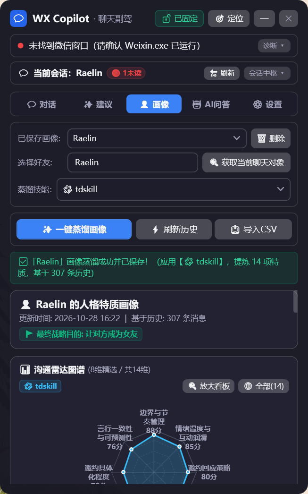 | 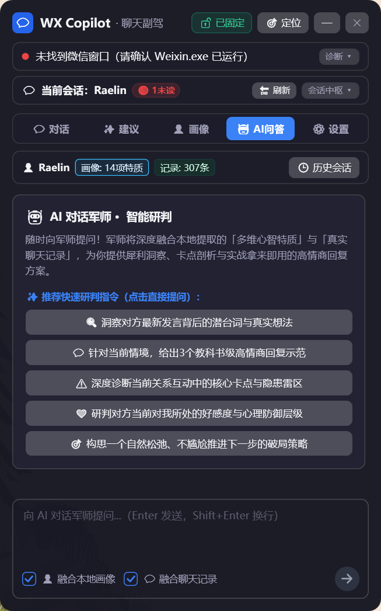 |

---

### 2. 双全景深度研判大看板 (复合图表全屏分析)

| ⚔️ 话语力量与博弈推演全景大看板 (AdviceAnalyticsWindow) | 🔍 联系人多维画像全景放大看板 (PersonaAnalyticsWindow) |
| :---: | :---: |
| 多方案重叠雷达、动态维度柱状对决、博弈双轴象限与沙盘推演 | 4 大动态主导特质卡片、全景认知雷达、得分对比柱状与走势折线 |
| 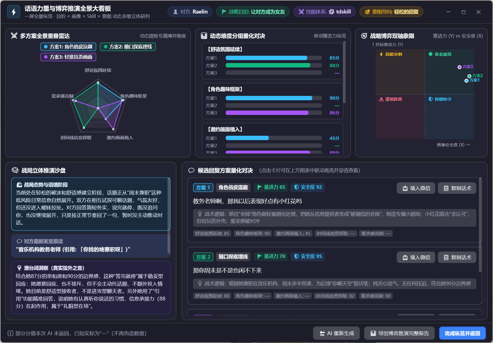 | 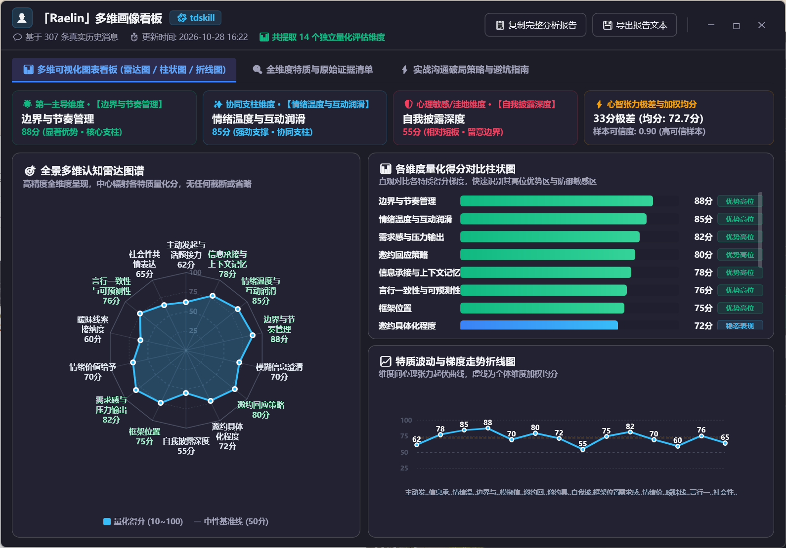 |

---

### 3. 全新集成设置中心与系统指南 (6 大专区)

| 🤖 AI 模型与服务设置 | 💬 本地WX与数据库 (WCDB4 直连) | 🧬 技能中心 (Skill Studio) |
| :---: | :---: | :---: |
| OpenAI 兼容接口配置与 DPAPI 硬件级加密 | WX 4.x 数据库直连、自动嗅探与只读游标测试 | Antigravity 风格技能文件夹递归绑定与热重扫 |
| 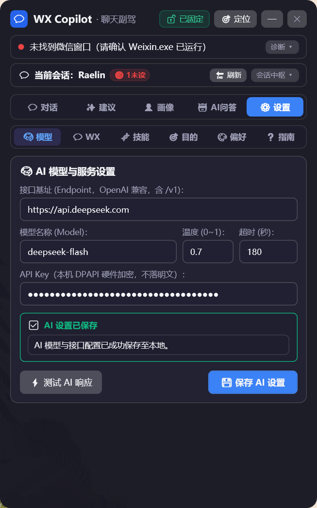 | 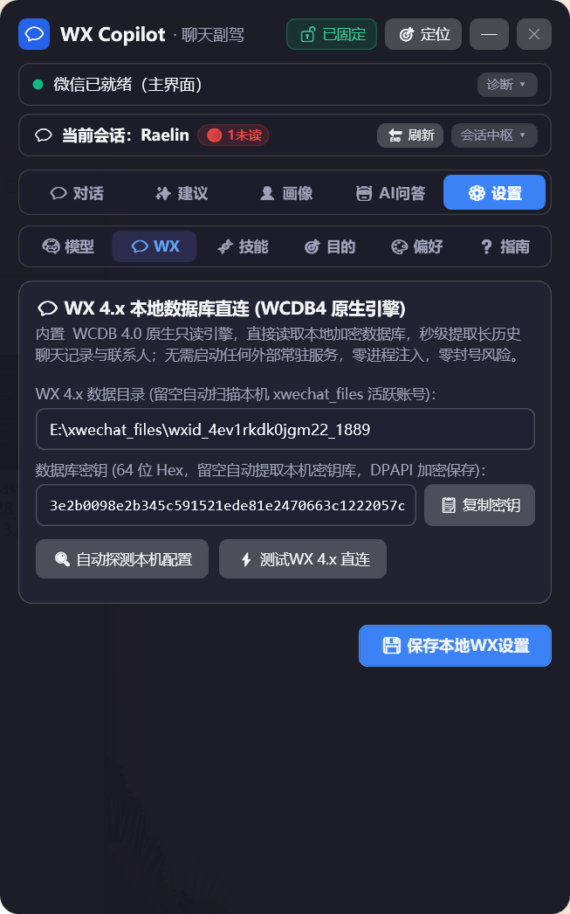 | 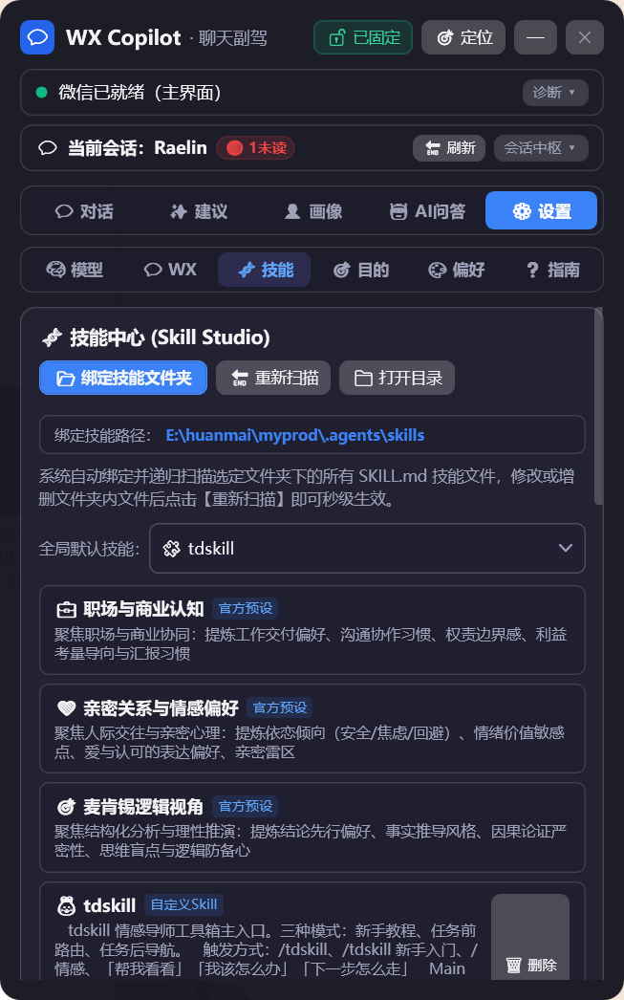 |

| 🎯 画像目的与战略管理 | 🎨 偏好与系统设置 (明暗主题) | ❓ 全局快捷键与指南 |
| :---: | :---: | :---: |
| 为好友配置专属终极战略目的 (Chat Objective) | Fluent 深浅主题热重载、语境跨度与透明度调节 | 快捷键一览、WCDB4 直连与本地优先安全说明 |
| 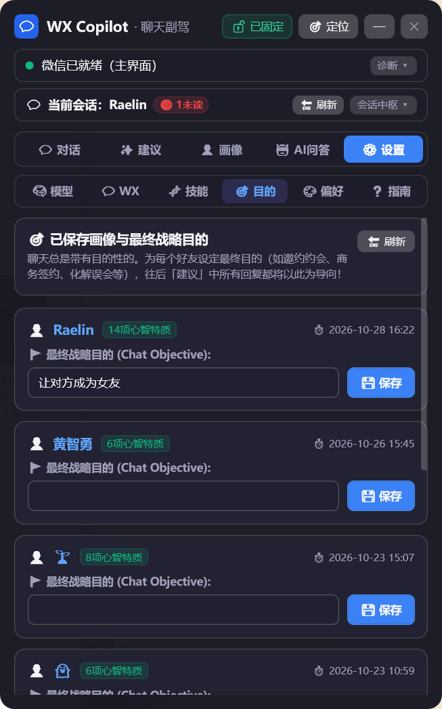 | 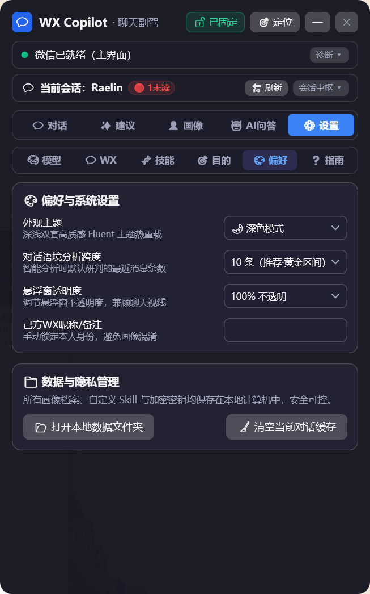 | 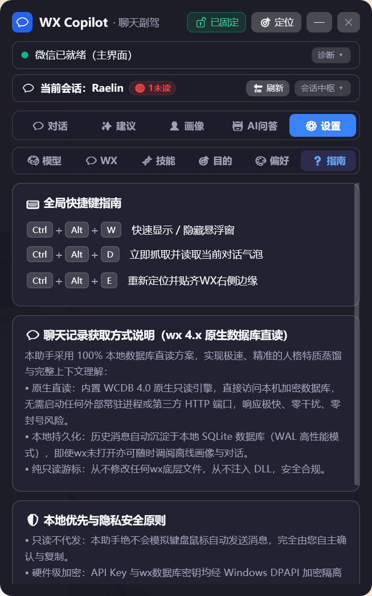 |

---

## ✨ 核心特性

### 1. 📌 智能贴边吸附、同层级沉浮与自由缩放拖拽 (Companion Layer & Resizing)
- **WX窗口自适应定位**：支持WX主窗口（`WeChatMainWndForPC`）与独立单聊窗口（`ChatWnd`），自动吸附贴边。
- **智能生命周期感知（协同隐藏与唤醒）**：全面感知WX最小化（`-`）与点击右上角 `X` 隐藏至系统托盘（`SW_HIDE`）；WX收起时副驾同步隐藏，用户从托盘或任务栏唤出WX时毫秒级自动恢复重现。
- **智能前台感知与动态 Z-Order（同层级沉浮）**：告别霸道全局置顶！副驾在跟随模式下与WX保持同一 Z 轴层级（紧随WX之后且不抢输入焦点）。当切到全屏浏览器、VS Code 或 Office 时，副驾随WX同步沉降至后台，绝不遮挡其他工作；切回WX时毫秒级协同回到前台；点击“🔓 已固定”可维持全局置顶与任意拖拽。
- **平滑无抖跟随**：实时感知WX窗口移动、缩放与跨多显示器拖拽，毫秒级平滑跟随。
- **边框自由缩放调节**：鼠标移动到悬浮窗边框或四角时，自动显示双向/四向调整光标，支持 8 个方向自由拉伸放大缩小，窗口尺寸防抖持久化记忆。

### 2. 🎨 Fluent 明暗双主题动态热重载 (Dark & Light Themes)
- **深浅主题无缝切换**：在设置中支持**深色模式 (Fluent Dark)**、**浅色模式 (Fluent Light)** 与**跟随系统 (System)** 动态热切换，无需重启即刻刷新全窗口调色板。
- **全要素高对比度保证**：浅色模式下白底黑字清爽利落、阴影通透；深色模式深邃科技感，彻底杜绝任何“白底白字”或隐形文字。

### 3. 🌐 WX会话与数据中枢 (WeChat Data Hub & Analytics)
主界面在 Tab 导航上方独家内置与“WX已就绪”风格一致的**数据中枢折叠下拉栏**，支持一键展开/折叠，集成 5 大高阶数据洞察与交互子视图：
- **💬 最近会话快速切换 (Recent Sessions)**：直连本地 WC 数据库，通过严格算法清洗并过滤公众号、系统号与群聊，严格按最新消息时间倒序呈现单聊好友（包含**备注名、WX昵称、未读红点计数与时间**），点选好友后即可在【对话】、【建议】、【画像】与【AI问答】中同步切换沟通对象，并秒级载入完整气泡；
- **📊 关系冷热看板与互动统计 (Relationship Heat & Analytics)**：自动洞察双方互动紧密度，实时统计**总消息条数**、**往来平衡比例**（我方 % vs 对方 %）、**平均响应时延**、**深夜畅聊频次 (23:00~06:00)**，并基于活跃天数、消息密度与亲密度加权测算 **0~100°C 关系温度指数**，动态评定关系层级（极度密切 / 熟络热络 / 稳健温和 / 渐趋冰点）并输出指导建议；
- **🔔 未读主动提醒与破冰跟进雷达 (Unread Radar)**：毫秒级全库扫描所有未读单聊，按未读条数梯度标注（🔴 紧急未读 / 🟠 普通未读），支持一键点击“💬 切换跟进”自动定位好友并加载上下文，不漏回任何重要商机或好友互动；
- **🗓️ 聊天关键事件、约定与承诺备忘 (Commitments & Appointments)**：基于高精度中文自然语言模式，智能扫描提炼对话中的【📅 聚会约定】（见面/吃饭/改天/逛街）、【📑 交付承诺】（发文件/传合同/发票/查收）与【🤝 承诺表态】（保证/记得/晚点/尽快），形成行动清单；
- **🔍 跨会话全库关键词快速检索 (Full Database Search)**：支持输入关键词检索历史对话原话证据，毫秒级呈现匹配消息摘要、发言角色与时间戳证据，便于查证关键事实与历史原话。
- **100% 精准零乱码**：彻底告别屏幕截屏与 OCR 误差，通过内置 WCDB 4.0 原生只读游标直连本地数据库（配合 SQLite 离线缓存），精准区分收发方向并自动清洗 XML 卡片、引用回复与表情标签。
- **自动读取与最新消息跟随**：开启【自动读取】后，自动同步当前会话或最新活跃单聊消息，并异步沉淀至本地 SQLite 数据库。

### 4. 🧠 冷链路：动态 Skill 认知蒸馏与心智雷达图谱 (Cognitive Skill & Radar)
- **可插拔官方三大认知预设**：
  - 💼 **职场与商业认知 (`workplace`)**：提炼交付导向、推进能动性、权衡决策法、职业防备心、利益诉求导向与职场禁忌；
  - ❤️ **亲密关系与情感偏好 (`intimacy`)**：提炼情感表达、依恋安全感、推进节奏、情绪敏感度、核心情感需求与亲密禁忌雷区；
  - 🎯 **麦肯锡逻辑视角 (`logical`)**：提炼结构化表达、事实求证度、因果推导严密、辩论抗逆力、逻辑闭环度与逻辑反模式。
- **Antigravity 风格技能文件夹绑定**：
  - 彻底抛弃繁琐的单文件导入与手动表单，支持直接绑定本地技能文件夹；
  - 系统自动递归扫描所有子目录下的 `SKILL.md` / `skill.md` 技能定义；
  - 支持【📂 绑定技能文件夹】、【🔄 重新扫描】与【📁 打开目录】；
  - 自定义技能删除时同步安全清理底层物理文件与缓存，刷新绝不复现。
- **画像全景深度分析看板 (`PersonaAnalyticsWindow`)**：
  - 配备现代化顶部全景边框（支持全屏拖拽、双击缩放、最小化 `─`、最大化/还原 `🗖`、关闭 `✕`）；
  - **顶部 4 大动态主导特质卡片**：自动提炼【第一主导维度】、【协同支柱维度】、【心理敏感/洼地维度】与【心智张力极差与加权均分】，绝不写死维度，随技能与画像动态计算；
  - **多图表联动呈现**：全景多维认知雷达图谱、各维度量化得分对比柱状图、特质波动与梯度走势折线图；
  - **全维度特质与原始证据左右对照清单**：左侧清晰展现特质推断，右侧逐项印证亲口原话引用；
  - **AI 定制实战破局策略与避坑指南**：结合画像证据、当前技能体系、终极目的与最近真实对话，由大模型针对该联系人生成定制化四卡片策略报告（带 SHA256 内容指纹缓存、一键重新生成与本地模板即时兜底）；
  - 支持一键复制完整 Markdown 分析报告与导出文本。

### 5. 🤖 AI 问答军师与 Antigravity 交互体系 (AI Chat Advisor & Antigravity UX)
- **Antigravity 交互美学设计**：精心对齐 Antigravity 工具的现代科技质感，包含深浅双主题自适应气泡、极简圆环发送箭头按钮与流式交互。
- **融合本地画像**：勾选【👤 融合本地画像】后，AI 自动调取当前好友的多维心智特质（核心维度得分、行为偏好、心理防御等），生成针对性量身定制的破局回复。
- **融合真实聊天记录**：勾选【💬 融合聊天记录】后，AI 自动调取最近多轮真实聊天上下文，拒绝空洞泛泛而谈，精准剖析当前对话症结。
- **推荐快速研判指令（探针）**：
  - 🔍 洞察对方最新发言背后的潜台词与真实想法
  - 💬 针对当前情境，给出 3 个教科书级高情商回复示范
  - ⚠️ 深度诊断当前关系互动中的核心卡点与隐患雷区
  - 💖 研判对方当前对我所处的好感度与心理防御层级
  - 🎯 构思一个自然松弛、不尴尬推进下一步的破局策略
- **多会话抽屉管理 (`QaSessionStore`)**：支持自由新建会话、切换历史会话、删除历史会话，会话数据独立在本地持久化保存。

### 6. 💾 SQLite 本地轻量化数据库持久化 (Local SQLite Database & Offline Sync)
- **统一本地数据底座**：采用 `Microsoft.Data.Sqlite` 在 `%AppData%\WeChatCopilot\copilot.db` 建立统一关系库，开启 WAL 模式支持高并发吞吐。
- **SHA256 唯一指纹幂等去重**：每条消息根据 `contact_name + role + text + timestamp` 生成唯一哈希，多次刷新历史均执行 `INSERT OR IGNORE`，绝不产生重复记录。
- **WCDB4 本地直连增量入库 + 离线秒级回退**：
  - 点击【⚡ 读取当前对话】或【刷新】时，自动从wx本地 WCDB4 数据库提取最新聊天记录并增量同步入库；
  - WX未运行或离线时，自动零延迟回退从本地 SQLite 加载历史对话，状态栏友好提示，**【✨ 一键蒸馏画像】在离线状态下完全可用**！
- **全链路消息自动入库**：无论是WX数据库直连同步还是 CSV 文件导入，均在后台静默异步写入 SQLite。
- **画像双向兼容**：画像与终极战略目的结构化存入 SQLite，同时保持本地 JSON 备份与平滑自动迁移。

### 7. ⚔️ 动态博弈立体研判与话语力量全景大看板 (`AdviceAnalyticsWindow`)
彻底告别刻板狭隘的“恋爱/情感”偏置与硬编码死板标签，升级为**全域战略沟通军师**（覆盖商务谈判、职场汇报、合作博弈、社交破冰、亲密关系等全场景）：
- **四大战略要素协同驱动**：根据当前对话对象的【终极战略目的】、【人物认知画像】、【激活作战Skill】与【用户期望的回复意图】进行分层立体研判。
- **自适应动态博弈维度**：由 AI 在推理时实时提炼 3～6 个专属博弈维度（如商务提炼：`商业主导权`、`筹码锁定`、`成单推进力`；向上管理提炼：`确定性交付`、`信任资产`、`边界防护`；社交破冰提炼：`舒适安全感`、`情绪共鸣`、`邀约契机`）。
- **多指标量化赋能**：每条候选回复均提供动态维度评分、**【🚩 目标推进力】**（0-100）与**【🛡️ 画像安全度】**（0-100）。
- **一屏全景纵览复合图表大看板**：
  - **图表 1（多方案全景重叠雷达图）**：基于动态维度多边形，方案 1（流光天蓝）、方案 2（翡翠绿）、方案 3（紫罗兰）半透明重叠绘制，直观展现攻防形态覆盖；
  - **图表 2（动态维度分组对决柱状图）**：按动态维度横向并排对比各候选回复方案的量化得分，单项爆发力一目了然；
  - **图表 3（战略博弈双轴象限图）**：纵轴【推进力】vs 横轴【安全度】，方案清晰定位在**🌟 黄金破局**、**⚡ 高能突刺**、**🛡️ 稳健防守**、**⚠️ 谨慎踩雷**四大象限；
  - **战局沙盘与卡片联动高亮**：点击方案卡片可在图表中联动高亮聚焦，支持一键快捷复制话术与导出 Markdown 战局推演报告。

### 8. 🎯 终极战略目的与多轮语境深度调节 (Strategic Goals & Context Depth)
- **多轮语境深度可调**：支持快捷切换或自定义分析深度（最近 3 条、5 条、10 条、15 条、20 条），避免孤立研判最后一句话，全面捕捉语境脉络与情感演进。
- **联系人终极战略目的管理**：为每位好友持久化设定终极战略目的，一键直达编辑与管理，所有回复建议均以目的达成为最高推进锚点。

### 9. ⚙️ 全新集成设置中心 (Settings Hub)
主界面内嵌 6 大设置专区，告别多窗口切换：
1. **🤖 AI 模型与接口**：配置 API 基础路径、模型名称、温度系数、超时设置、密码级 DPAPI 密钥与连通性测试；
2. **💬 本地WX与数据库直连**：配置WX 4.x 本地数据库目录与 64 位 SQLCipher 密钥（支持一键自动探测本机配置与 WCDB4 直连读取测试）；
3. **🧬 技能中心 (Skill Studio)**：查看当前生效技能，绑定技能文件夹、递归扫描发现、打开目录与物理安全删除；
4. **🎯 画像战略目的 (Goals)**：统一查看和管理所有联系人的终极战略目的；
5. **🎨 偏好与系统**：外观主题（深色/浅色/跟随系统）、悬浮窗透明度调节、己方WX昵称偏好与数据目录一键直达；
6. **❓ 使用指南与安全原则**：完整操作指引、快捷键一览、WX 4.x 直连技术细节、硬件级 DPAPI 与只读游标零风控原则。

### 10. 🛡️ 本地优先与安全防护 (Security & Privacy)
- **DPAPI 硬件级加密**：API Key 与WX数据库密钥仅通过 Windows DPAPI 本地加密存储，磁盘无明文。
- **纯文件只读游标**：WCDB4 直连引擎采用纯文件只读游标（Read-Only WAL Cursor），不扫描WX进程内存、不注入 DLL、不 Hook 任何系统函数，从根源确保WX账号零风险。
- **无第三方云端中转**：除直连用户配置的大模型端点外，绝无任何开发者云端遥测与数据回传。
- **全方位测试守护**：**200 项自动化单测**守护核心业务算法、WCDB4 解密与解析、关系冷热指标、未读雷达、约定提炼、全库检索、提示词组装、策略手册生成、SQLite 持久化、AI 问答会话模型与 XAML 静态/动态资源契约。

---

## 🏛️ 系统架构

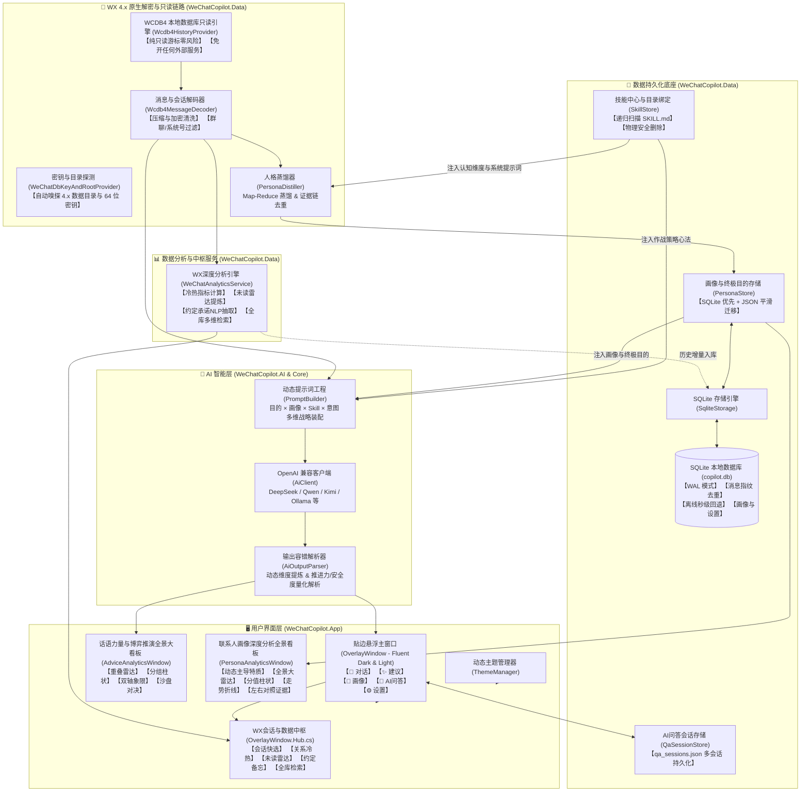

---

## 📂 项目结构

```text
e:\huanmai\myprod
├── pic/                                  # 软件高清界面截图目录
│   ├── Snipaste_2026-10-28_17-25-09.png  # 对话 Tab：实时对话气泡、引用回复与富媒体呈现
│   ├── Snipaste_2026-10-28_17-25-33.png  # 建议 Tab：终极目的驱动、多方案卡片与量化推进力
│   ├── Snipaste_2026-10-28_17-25-42.png  # 放大看板：话语力量与博弈推演全景复合大看板
│   ├── Snipaste_2026-10-28_17-25-59.png  # 画像 Tab：特质蒸馏、多维认知雷达图谱与证据链
│   ├── Snipaste_2026-10-28_17-26-07.png  # 放大看板：联系人多维画像全景复合图表放大看板
│   ├── Snipaste_2026-10-28_17-26-14.png  # AI问答 Tab：对话军师、深度研判指令与 Antigravity 交互
│   ├── Snipaste_2026-10-28_17-26-23.png  # 设置 Tab：AI 模型与接口配置 (DPAPI 硬件级加密)
│   ├── Snipaste_2026-10-28_17-26-33.png  # 设置 Tab：本地 WX 4.x 数据库直连与密钥探测 (WCDB4)
│   ├── Snipaste_2026-10-28_17-26-41.png  # 设置 Tab：技能中心 (Skill Studio 文件夹绑定)
│   ├── Snipaste_2026-10-28_17-26-49.png  # 设置 Tab：联系人终极战略目的管理 (Chat Objective)
│   ├── Snipaste_2026-10-28_17-26-53.png  # 设置 Tab：偏好与 Fluent 明暗双主题动态热重载
│   └── Snipaste_2026-10-28_17-26-59.png  # 设置 Tab：全局快捷键速查与架构安全指南
│
├── src/
│   ├── WeChatCopilot.App/        # 应用程序主工程 (WPF + XAML + Fluent 主题)
│   │   ├── OverlayWindow.xaml    # 贴边悬浮窗主界面 (WX数据中枢 + 5 大 Tab 导航)
│   │   ├── OverlayWindow.xaml.cs # 交互事件、雷达图动态绘制、自动吸附与缩放对齐逻辑
│   │   ├── OverlayWindow.Hub.cs  # WX数据中枢 (冷热看板、未读雷达、约定备忘、全库检索)
│   │   ├── OverlayWindow.Chat.cs # 对话读取、会话切换与实时气泡渲染
│   │   ├── OverlayWindow.Advice.cs # 建议生成、博弈推演与回复卡片
│   │   ├── OverlayWindow.Persona.cs# 人物画像蒸馏、雷达多边形与特质标签
│   │   ├── OverlayWindow.Qa.cs   # AI 问答对话军师多会话管理与探针交互
│   │   ├── OverlayWindow.Settings.cs # 6 大设置专区交互与热重载
│   │   ├── ChatBubbleHelper.cs   # 富媒体气泡构建 (引用高亮/表情包/图片预览/药丸徽章)
│   │   ├── WeChatCdnMediaDownloader.cs # 微信表情与富媒体资源本地缓存探测与下载
│   │   ├── AdviceAnalyticsWindow.xaml    # 话语力量全景大看板 (重叠雷达/分组柱状/双轴象限)
│   │   ├── AdviceAnalyticsWindow.xaml.cs # 全景图表 Canvas 绘制与卡片联动交互引擎
│   │   ├── PersonaAnalyticsWindow.xaml   # 联系人画像深度看板 (现代化顶部边框与多图表)
│   │   ├── PersonaAnalyticsWindow.xaml.cs# 画像雷达图/柱状图/折线图绘制与报告导出
│   │   ├── ThemeManager.cs       # 明暗双主题 (Dark/Light/System) 动态热重载管理器
│   │   └── App.xaml / App.xaml.cs# 全局生命周期管理、未捕获异常穿透拦截与日志记录
│   │
│   ├── WeChatCopilot.Core/       # 核心业务逻辑与领域模型
│   │   ├── Abstractions/         # IChatHistoryProvider 等核心接口契约
│   │   ├── Ai/                   # PromptBuilder、AiOutputParser、PersonaDistiller、StrategyPlaybookGenerator
│   │   └── Models/               # Persona、DistillSkill、UnifiedAiAdvice、QaSession、WeChatEmojiTable
│   │
│   ├── WeChatCopilot.AI/         # 大模型通信层 (OpenAI 协议兼容客户端)
│   │   └── OpenAiCompatibleProvider.cs # OpenAI 兼容聊天补全提供商 (含超时与错误处理)
│   │
│   ├── WeChatCopilot.Windows/    # Windows 底层交互与 Win32 Interop
│   │   ├── WindowLocator.cs      # WX主窗口与独立单聊窗口探测
│   │   ├── WindowTracker.cs      # 窗口移动/尺寸变化实时监听追踪
│   │   └── HotkeyManager.cs      # 全局快捷键注册与消息泵路由
│   │
│   └── WeChatCopilot.Data/       # 数据持久化与 WCDB4 直连引擎
│       ├── Wcdb4HistoryProvider.cs # WX 4.x WCDB4 本地数据库只读提供者
│       ├── Wcdb4MessageDecoder.cs # WX 4.x WCDB 消息与单聊会话解码器
│       ├── Wcdb4NativeInterop.cs  # WCDB 4.x 原生 C 库 P/Invoke 动态互操作
│       ├── WeChatDbKeyAndRootProvider.cs # WX本地数据库目录与 64 位密钥自动嗅探
│       ├── WeChatDatImageDecoder.cs # 微信 .dat 加密图片异或魔数自动探测与解码
│       ├── WeChatAnalyticsService.cs # 关系冷热研判、未读雷达、约定提取与全库搜索
│       ├── CompositeChatHistoryProvider.cs # 复合历史消息提供通道 (WCDB4 直连 + SQLite 缓存)
│       ├── SqliteStorage.cs      # SQLite 本地轻量化存储引擎 (WAL模式、消息指纹去重、离线缓存)
│       ├── SkillStore.cs         # 技能目录绑定、递归扫描发现与物理安全删除
│       ├── PersonaStore.cs       # 联系人画像与终极战略目的本地存储 (SQLite优先/双写兼容)
│       ├── StrategyPlaybookStore.cs # 画像实战策略手册缓存持久化
│       ├── QaSessionStore.cs     # AI 问答多会话历史记录本地持久化
│       ├── SettingsStore.cs      # 系统设置（主题/透明度/语境条数）持久化
│       └── Security/DpapiProtector.cs # Windows DPAPI 硬件级敏感数据加解密
│
├── tests/
│   └── WeChatCopilot.Tests/      # xUnit 自动化测试工程 (200 项测试全覆盖)
│       ├── WeChatAnalyticsServiceTests.cs # 关系冷热、未读雷达、约定承诺抽取与全库检索测试
│       ├── Wcdb4MessageDecoderTests.cs   # WCDB4 消息反序列化、会话排序过滤与备注解析测试
│       ├── CompositeChatHistoryProviderTests.cs # 复合提供者通道测试
│       ├── WeChatDbKeyAndRootProviderTests.cs # 数据库目录与密钥提供器测试
│       ├── WeChatRichMediaTests.cs       # 微信 .dat 异或加密图片反解、表情映射与富媒体测试
│       ├── StrategyPlaybookGeneratorTests.cs # 实战策略手册生成、JSON 容错解析与缓存键测试
│       ├── AiQaAndCustomRelationshipTests.cs # AI问答界面结构、会话持久化与看板契约验证
│       ├── SqliteStorageTests.cs         # SQLite 表初始化、消息去重排序、画像与技能持久化测试
│       ├── SkillStoreTests.cs            # 技能绑定、递归扫描发现与物理安全删除测试
│       ├── PersonaDistillerTests.cs      # 画像蒸馏算法、证据过滤与可信度测试
│       ├── OverlayWindowXamlResourceTests.cs # XAML 静态/动态资源契约与 ThemeManager 测试
│       ├── PromptBuilderTests.cs         # 动态博弈维度提示词工程与装配测试
│       ├── AiOutputParserTests.cs        # 动态维度与推进力/安全度容错解析测试
│       └── SettingsStoreTests.cs         # 基础与外观配置读写测试
│
├── installer/                    # Inno Setup 自动化安装包工程配置
│   ├── WeChatCopilot.iss         # Inno Setup 安装包编译脚本 (现代向导风格)
│   └── ChineseSimplified.isl     # 简体中文向导语言资源
│
├── .github/workflows/
│   └── release.yml               # GitHub Actions CI/CD (全自动版本自增打包发布)
├── build_package.ps1             # 一键打包发布脚本 (生成 Setup.exe 与绿色单文件)
├── Directory.Build.props         # 统一项目属性与 BaseVersion 版本控制
├── WeChatCopilot.slnx            # 现代化 .NET 解决方案配置
└── README.md                     # 项目说明文档
```

---

## 🚀 快速开始

### 1. 环境准备
- **操作系统**：Windows 10 (Build 19041+) / Windows 11 x64
- **开发与运行环境**：[.NET 10 SDK (LTS)](https://dotnet.microsoft.com/download/dotnet/10.0)
- **WX桌面端**：WX Windows PC 端 3.x 或 4.x
- **大模型 API**：支持任意 OpenAI 兼容端点（如 DeepSeek、通义千问、Kimi、Moonshot、Ollama、vLLM 等）
- **WX 4.x 数据库直连**：内置 WCDB 4.0 原生只读解密引擎，自动探测本机账号与 64 位密钥，无需安装任何外部常驻服务与 OCR 工具，纯只读游标零风控；
- **本地持久化存储**：内置本地 SQLite 高性能 WAL 模式关系库，离线也能秒级查阅历史与画像。

### 2. 编译与测试

```bash
# 1. 克隆代码仓库
git clone git@github.com:jiang225638/wechat-assistant.git
cd wechat-assistant

# 2. 运行自动化测试 (200 项测试全绿)
dotnet test

# 3. 编译主程序 (Release)
dotnet build WeChatCopilot.slnx -c Release
```

### 3. 启动应用

```bash
# 直接启动应用
dotnet run --project src/WeChatCopilot.App
```

启动后，悬浮窗将自动搜索并贴合吸附在WX聊天窗口的右侧。

---

## 📦 打包发布 (EXE 安装文件)

本项目提供开箱即用的自动化打包脚本与 GitHub Actions 持续集成工作流，可一键生成**标准安装向导安装包（Setup.exe）**与**绿色独立单文件版（Portable.exe）**。

### 1. 产物类型与特点

所有本地打包产物均输出在项目根目录的 `dist/` 文件夹下：

| 产物文件 | 文件大小 | 类型说明 | 特点与优势 |
| :--- | :--- | :--- | :--- |
| **`WeChatCopilot_Setup_v1.0.x.exe`** | **~55 MB** | **标准 Windows 安装包**（强烈推荐） | 包含简体中文向导、自定义安装目录、创建桌面/开始菜单快捷方式、Windows 控制面板标准卸载、支持无管理员权限安装，支持升级自动覆盖。 |
| **`WeChatCopilot_Portable_v1.0.x.exe`** | **~80 MB** | **绿色免安装单文件版** | 纯单个可执行程序，无需安装与解压，双击即可运行，方便放 U 盘或快速尝鲜。 |

> 🛡️ **运行环境自包含 (Self-Contained)**：  
> 两个产物均已内置 **.NET 10 Desktop 运行时**，目标用户的 Windows 电脑**无需提前安装 .NET 10 SDK 或任何依赖库**，直接双击运行！

---

### 2. 一键本地打包脚本

项目根目录预置了自动化打包脚本 [`build_package.ps1`](file:///e:/huanmai/myprod/build_package.ps1)。在 PowerShell 中执行即可：

```powershell
# 1. 默认一键生成安装包与绿色单文件
powershell -ExecutionPolicy Bypass -File .\build_package.ps1

# 2. 指定自定义版本号打包 (例如发布 v1.0.2)
powershell -ExecutionPolicy Bypass -File .\build_package.ps1 -Version "1.0.2"

# 3. 仅构建安装包（跳过单文件以加快打包速度）
powershell -ExecutionPolicy Bypass -File .\build_package.ps1 -IncludeSingleFile:$false
```

---

### 3. GitHub Actions 全自动版本递增发布

项目已集成全自动 CI/CD 工作流 [`.github/workflows/release.yml`](file:///e:/huanmai/myprod/.github/workflows/release.yml)：
- 每次您执行 `git push` 到 `main` 分支后，GitHub Actions 会**基于构建序号自动递增版本号**（`v1.0.1` -> `v1.0.2` -> `v1.0.3`...）；
- 自动编译、运行测试并发布到 GitHub Releases，附带标准安装包与绿色便携版下载，免去手动修改版本号与打标签的繁琐流程。

---

## ⚙️ 设置与功能指南

### 1. AI 接口与模型配置
在【设置】->【🤖 AI 模型与接口】中配置：

| 配置项 | 示例值 | 说明 |
|---|---|---|
| **接口基址** | `https://api.deepseek.com/v1` | OpenAI 兼容接口基础 URL（需带 `/v1`） |
| **模型名** | `deepseek-chat` | 推荐使用推理或通用对话大模型 |
| **温度系数** | `0.4` | 推荐 0.3~0.7，值越低逻辑越收敛，值越高回复越丰富多样 |
| **超时时间** | `180` | 秒（长历史或复杂推理推荐设为 180~300 秒） |
| **API Key** | `sk-xxxxxxxxxxxxxxxx` | 仅在本地通过 Windows DPAPI 加密保存，绝不落盘明文 |

> 💡 **连通性探测**：配置完毕后点击【⚡ 测试 AI 响应】，系统将发送轻量握手请求，并实时回显连通状态与往返延迟（ms）。

### 2. 本地WX与数据库直连 (WeChat 4.x)
在【设置】->【💬 本地WX】中配置：

| 配置项 | 示例值 | 说明 |
|---|---|---|
| **WX 4.x 数据目录** | `E:\xwechat_files\wxid_xxxx_xxxx` | 留空时点击【🔍 自动探测本机配置】系统自动扫描最新活跃账号 |
| **数据库密钥 (SQLCipher)** | `d8b5a...64位Hex` | 留空时系统自动从本机加密密钥库提取，经 DPAPI 加密保存 |

> 💡 **秒级直连探测**：点击【⚡ 测试WX 4.x 直连】，内置 WCDB4 原生引擎将在 1 秒内建立只读游标、自动解析解密并回显联系人与消息统计。

### 3. 技能中心 (Skill Studio)
在【设置】->【🧬 技能中心】中：
- **官方内置认知技能**：随时在全局下拉框中切换【💼 职场与商业认知】、【❤️ 亲密关系与情感偏好】或【🎯 麦肯锡逻辑视角】；
- **📂 绑定技能文件夹 (Antigravity 风格)**：点击【绑定技能文件夹】选择工作区或任意包含技能的目录（如 `.agents/skills`），系统自动递归扫描并展示其下所有子文件夹中的 `SKILL.md` / `skill.md`；
- **🔄 重新扫描**：本地修改或新增 `SKILL.md` 文件后，点击【重新扫描】即可秒级热生效；
- **📁 打开目录**：一键在 Windows 资源管理器中打开当前绑定的技能库文件夹；
- **安全物理删除**：对自定义技能点击【🗑️ 删除】，不仅清除内存缓存，且同步安全清理磁盘对应物理文件与目录，刷新后绝不再复现。

### 4. 终极目的战略管理 (Goals)
在【设置】->【🎯 画像战略目的】中：
- 查看已保存的联系人列表与其对应的终极战略目的；
- 随时修改或添加目标，并在「建议」面板中直观高亮展示。

### 5. 偏好与系统设置
在【设置】->【🎨 偏好】中：
- **外观主题**：自由切换深色（Dark）、浅色（Light）与跟随系统（System）；
- **悬浮窗透明度**：支持调节 85%~100% 窗口透明度；
- **己方WX昵称**：配置本人的WX昵称，确保历史对话中发言方精准识别与证据去重；
- **本地 SQLite 数据库**：聊天消息、多维画像、技能与设置统一持久化存储在 `%APPDATA%\WeChatCopilot\copilot.db` 中。开启 WAL 模式支持高并发读写；消息通过 SHA256 唯一指纹幂等去重；在离线状态下亦可直接秒级读取本地历史进行画像蒸馏与 AI 建议；
- **数据目录**：点击【📁 打开数据文件夹】，一键打开 `%APPDATA%\WeChatCopilot\`，便捷查看数据库文件 `copilot.db`、配置文件与异常日志；
- **缓存重置**：支持一键清空当前对话气泡缓存。

### 6. 指南与安全原则
在【设置】->【❓ 指南】中：
- 完整键盘快捷键一览与交互操作指引；
- wx 4.x WCDB4 原生只读游标架构与技术细节；
- 硬件级 DPAPI 密钥加密与本地优先原则阐释。

---

## ⌨️ 快捷键指南

| 快捷键 | 功能 | 说明 |
|---|---|---|
| <kbd>Ctrl</kbd> + <kbd>Alt</kbd> + <kbd>W</kbd> | **显示 / 隐藏悬浮窗** | 全局切换助手面板可见性 |
| <kbd>Ctrl</kbd> + <kbd>Alt</kbd> + <kbd>E</kbd> | **重新吸附WX** | 强制重新检索WX窗口并调整对其位置 |
| <kbd>Ctrl</kbd> + <kbd>Alt</kbd> + <kbd>D</kbd> | **读取当前对话** | 立即从WX本地数据库直读并同步最新对话气泡 |

*注：亦可通过悬浮窗顶部标题栏拖拽移动；点击【📌 吸附中/已固定】可切换自由摆放模式；鼠标移至窗口四周边缘可随意缩放窗口大小。*

---

## 🔒 隐私、安全与日志

- **绝无云端中转**：本项目完全开源，不设任何自建中转服务器，所有 AI 调用直接发送至用户配置的端点。
- **免杀与账号安全**：采用纯文件只读游标直连解密数据库，**不注入 DLL、不 Hook 内存、不修改WX文件**，彻底杜绝封号隐患。
- **凭据硬件隔离**：API Key 与WX数据库密钥经 Windows DPAPI（绑定当前 Windows 登录账户密钥派生）强加密存储，配置文件移至其他设备均无法解密。
- **全局异常拦截与日志**：
  - 运行期未捕获异常自动写入 `%APPDATA%\WeChatCopilot\crash.log`；
  - 遇到未知错误时自动穿透并提取底层原因，并提供弹窗一键直达日志文件夹。

---

## 🧪 自动化测试

项目内置完善的自动化测试矩阵，覆盖 WCDB 4.0 原生只读、关系冷热计算、未读雷达、约定备忘正则提取、全库检索、提示词工程、算法去重、大模型响应容错解析、SQLite 存储与迁移、AI问答会话模型、XAML 静态/动态资源契约防御与 DPAPI 加密：

```bash
dotnet test
```

测试覆盖概览（**200 项全通过**）：
- `WeChatAnalyticsServiceTests`：关系冷热指数与等级研判、未读雷达排序过滤、约定承诺提炼（聚会/交付/表态）、大小写不敏感全库检索测试；
- `WeChatDbKeyAndRootProviderTests`：xwechat_files 活跃账号目录自动发现、DPAPI/AES-256-GCM 密钥库提取与 ASCII Junction 桥接探测测试；
- `Wcdb4MessageDecoderTests`：WX 4.x Zstd 压缩包解压、XML 卡片/表情/引用回复结构化解析、活跃单聊清洗过滤与会话排序测试；
- `CompositeChatHistoryProviderTests`：WCDB4 直连与本地 SQLite 离线双层降级通道及聚合统计测试；
- `OpenAiCompatibleProviderTests`：OpenAI 兼容端点网络探测、超时配置与异常容错测试；
- `StrategyPlaybookGeneratorTests`：AI 实战破局策略与避坑指南请求组装、JSON 容错解析、缓存键失效以及建议分值如实展示（不伪造缺失分）测试；
- `AiQaAndCustomRelationshipTests`：AI 问答主界面结构、会话存储与加载、Antigravity 交互组件契约、画像分析看板纯净契约验证；
- `SqliteStorageTests`：SQLite 数据库初始化与 WAL 模式、消息 SHA256 指纹幂等去重、按时间顺序检索、画像与战略目的存取以及键值配置测试；
- `SkillStoreTests`：Antigravity 风格技能文件夹绑定、多层递归自动扫描、Markdown YAML 元数据解析、当前技能持久化与物理安全删除测试；
- `PersonaStoreTests`：画像本地持久化、SQLite 优先读取与已有旧版 JSON 文件的透明双向自动迁移测试；
- `OverlayWindowXamlResourceTests`：**XAML 静态与动态资源契约自动巡检**，守护 `OverlayWindow`、`AdviceAnalyticsWindow`、`PersonaAnalyticsWindow` 资源完整性与 `ThemeManager` 画刷全覆盖；
- `PersonaDistillerTests`：多技能心智蒸馏、自定义 Skill 动态装配、事实证据链过滤、可信度解析与 Map-Reduce 去重；
- `AiOutputParserTests`：一体化 AI 建议多风格容错解析、动态博弈维度提取、推进力与安全度量化评分；
- `PromptBuilderTests`：多轮语境深度拼接、角色标注、动态博弈维度提示词工程与装配；
- `SettingsStoreTests` & `DpapiProtectorTests`：本地数据加解密、主题模式读写与用户隔离验证。

---

## 📄 开源许可证

本项目采用 [MIT License](LICENSE) 开源许可证。

---

## ⚠️ 免责声明

1. 本软件仅供技术交流、学习及个人日常沟通辅助使用。
2. 本软件遵守WX官方相关使用规范，不提供任何自动回复、消息群发、机器人代发等可能破坏生态平衡的功能。
3. 用户因自行配置的大模型所产生的内容合规性与使用责任由用户自行承担。
